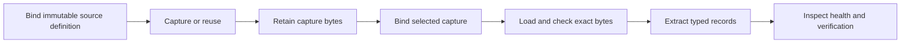

# Career Fleet source Blocks

The twelve source capabilities are now actual `aeltum.block.v2` artifacts, published by Forge and referenced by exact name/digest in the discovery Process. The former configuration catalog and its runtime API have been removed.

Current development Process: `company_discovery.v1@39c530dcb5c79d1225636122e3fe3ba7139c7a70a2bbbaf53eb93ee982254d1a`.

## What executes

Each published source Block composes seven exact Node definitions, eight typed edges, a typed state input and typed state/next outputs:



The source definition is an immutable `fills.source` value on the binding Node. It is included in the Block's native content digest. Its URL, CSS selectors, JSON pointers, readiness and pagination cannot be replaced by request data. Each Block is flattened into the Process under its own namespace. The Process owns selection, recurrence, recovery, receipts and the final result. No factory services remain at runtime.

The opening Node resolves `request.source_blocks[].block` against its compiled inventory. Unknown/stale references and caller-supplied Block configuration refuse before acquisition. Caller query/page choices remain explicit typed task data. A retained capture still traverses the selected source Block; capture and retention can reuse the original bytes without another network read.

The source-selection Node's bundled `nodes/open/open/source_block_index.json` names all twelve artifacts. Packaging compares those references and the complete Block documents with Forge's actual composition result. It also checks the exact Node helper closures, source-selection resources and printed source inventory. The twelve published Block documents, catalog index and tokenizer license are flat assets in the source-selection Node package. Its source binds their digests, normal admission retains their exact bytes, and release printing verifies that source set. They are not loose unbound release files. The old source-configuration catalog is not an alternate capability registry.

## Commands

```sh
career-fleet blocks list
career-fleet blocks verify --id exhibitors.aquatech --run-directory runs/verify-aquatech --db research.db
career-fleet init --objective "enumerate exhibitors" --source exhibitors.filtech --enable-acquisition --output request.json
career-fleet campaign run --request request.json --directory campaigns/exhibitors --db research.db
```

MCP exposes `career_fleet_blocks_list` and `career_fleet_blocks_verify`, alongside discovery and campaign tools. `sources discover` finds candidate collections; `sources inspect` checks proposed source input data. A `structure_verified` candidate has not become a Block. Reusable capabilities are authored through Forge at build time, then composed into a new Process revision. There is no runtime scraper-construction loop or compatibility alias for the removed source-verification command.

## Source-bound verification

All twelve exact Blocks passed live listing extraction, a readable representative detail and an absent-mapping negative check against the original captured listing:

| Population | Block catalog IDs | Listing records |
| --- | --- | ---: |
| Associations | `associations.w3c`, `associations.khronos` | 308 + 113 |
| Exhibitors | `exhibitors.aquatech`, `exhibitors.filtech` | 20 + 601 |
| Suppliers | `suppliers.made_in_china`, `suppliers.indiamart` | 30 + 28 |
| Procurement | `procurement.contractsfinder`, `procurement.find_tender` | 199 + 6 |
| Geographic | `geographic.sf_chamber`, `geographic.tacoma_chamber` | 51 + 80 |
| Ecosystems | `ecosystems.cloudflare`, `ecosystems.vercel` | 7 + 3 |

Evidence is bound to the exact Block and Process references, event IDs and capture digests in `career_fleet/resources/source_block_evidence.json`. Each source-health result also carries its Block reference. The matrix retains 1,439 source/registry identities from 1,446 listing records. Global identity reconciliation remains partial; memberships can include non-business organizations, and websites remain source assertions.

Fifty-two Career Fleet regressions passed, including inspection of all emitted seven-Node Block documents, membership in the flattened Process, stale-reference refusal, rejection of changed Block references/artifacts during packaging, and workspace confinement. Go author-core tests and the standalone printed Go package checks passed. A real MCP client ran, replayed, resumed and refreshed an Aquatech Block campaign. Replay retained twenty organization records with zero network reads; refresh made a new public read. Both the CLI's `blocks verify` and MCP's `career_fleet_blocks_verify` passed against the live source.

Current exact Block evidence: [live source Block checks](/Users/nate/Documents/Codex/2026-10-16-career-fleet-admission/admitted-node-source-block-checks/verification.json). The [earlier MCP campaign checks](/Users/nate/Documents/Codex/2026-10-16-career-fleet-source-blocks/mcp-final-consumption.json) retain their original Process identity; they are not relabeled as consumption of this revision.

Earlier configuration-only executions remain separately labeled in their private snapshots. They are not relabeled as executions of these Blocks.

## Rebuild through Forge

Source declarations for build time are in `processes/company-discovery/author/source-block-inputs.json`. To extend or change them:

1. Run `python3 scripts/author_source_blocks.py prepare`.
2. Run `python3 scripts/sync_discovery_authoring.py --forge-root /absolute/forge`.
3. Check and publish `source-block-library-plan.json` using `forge-author plan` into a new directory. Its library mode publishes actual Block artifacts and pins.
4. Run `python3 scripts/author_source_blocks.py compose --library /absolute/new-library`, then synchronize again. This binds the published references into the Process and generates its immutable reference inventory.
5. Check and print `processes/company-discovery/plan.json` through `forge-author plan ... -develop` into a new directory, then package its output with `scripts/package_discovery_process.py` and build the standalone worker.
6. Run `PYTHONPATH=. python3 scripts/verify_source_blocks.py --evidence-directory /absolute/new-evidence --max-requests 12 --proof-output career_fleet/resources/source_block_evidence.json`.

The optional twelve-read allowance in that example is explicit per Block. It is not a product ceiling. The verification script records real-use observations; it does not publish or admit Blocks. Changed source configuration or implementations produce new Block references, then a new Process reference. Stale observations do not certify the new references.

The bundled package remains explicitly labeled as an unsigned development print. Factory qualification uses separately retained admission, release and native consumption artifacts. Geographic examples cover the A roster, Aquatech and Vercel cover their returned cards, and no exhaustive coverage or globally unique company count is claimed.

## Arbitrary data requests

Data fields do not belong to rungs. Any business carried in `request.prior` can receive any explicit `questions` and extraction rules, in either order. A new task can request the same field again even when prior assertions already populate it. Observed evidence, unknown values and conflicting assertions stay distinct. Explicit subject bindings attribute a document to its subject; finding a URL alone does not establish company identity.

The author-core tests cover arbitrary custom fields, unresolved businesses and refresh despite prior values. Native Process cases additionally exercise `fields_any_order`, `fields_reversed` and `refresh_prior_field` through actual public-page capture, local byte retention/loading, extraction and public delivery. These use an illustrative public document, not a fabricated business claim. A separate live MCP check carries Horizontal from the actual exported list, requests its reported service phrase and client segment in both orders, then requests the client segment again using the returned record unchanged. All three calls return source-bound values with zero network reads and zero inference. The MCP projection preserves absent optional properties instead of injecting nulls that cannot pass the next native request.

## Reproduce factory qualification

The Node source/test closure and authored checking method are separate from a successful development run. `scripts/prepare_discovery_admission.py` prepares representative success, independent held-out and exact safe-failure cases. `scripts/discovery-admission/main.go` checks native codification and positive-input schemas, then binds reviewed boundary assessments to exact Node/source/test digests. Recompute these after source or test changes; republish and recompose affected source Blocks.

`scripts/configure_discovery_qualification.py --evidence-root /absolute/new-root` binds the selected real retained capture store and pinned browser paths, 104 independently stated outcome requirements, and 18 Process cases. It supplies the normal plan's qualification handoff and an explicit `native-ao.work` selecting the current SDK, Outcome Engine, AOA and ABAC checkouts. Forge pins this workspace and uses the same dependency selection for intake and the native client build. Run it with `PYTHONPATH=.` from this checkout after publishing Blocks and installing current Forge tools.

Generate a new full plan through `forge-author plan`, then use its `qualification.json` with `forge-author qualify`. Qualification owns development cases, exact Node admission, release printing, receipt/coverage checks and native AO consumption. Resume only unchanged inputs; use a new attempt after a source, test, case or authority change. Interrupted and failed attempts remain evidence.

The fixed checking-method metadata describes one candidate trial with the selected 600-second qualification-owner allowance; it does not add a product acquisition ceiling. The local owner explicitly selects its existing `no_output_limit:true` mode with `max_output_bytes:0`; the prior 128 MiB selection was refused by the SDK’s 64 MiB descriptor ceiling before any AO case ran. Changing proof scope requires a newly versioned Node contract and fresh proof. Public GET request counts retain the exact Node policy, browser reads keep the caller's selected policy, and no paid inference is configured.

## Collected list and MCP data request

The [exported list](/Users/nate/Documents/Codex/2026-10-16-career-fleet-admission/company-source-records.json) contains 1,439 source/registry identities from the twelve source checks. It retains publisher assertions and provenance; global company reconciliation remains partial. The underlying append-only research database is beside the checks.

A fresh MCP client consumed this exact bundled revision, listed its source Blocks, then requested two arbitrary fields in reversed order from retained evidence. Both values returned with zero network requests and zero inference. The [MCP consumption record](/Users/nate/Documents/Codex/2026-10-16-career-fleet-admission/mcp-any-data/consumption.json) points to the original worker response carrying the exact Process identity. This is MCP integration evidence; native AO consumption remains a separate factory stage.

Actual-list request evidence: [three MCP data requests](/Users/nate/Documents/Codex/2026-10-16-career-fleet-admission/mcp-listed-business-fixed/consumption.json). These are publisher-reported phrases, with original quote/span/capture provenance, rather than independent verification of the company’s claims.

A [full-list MCP check](/Users/nate/Documents/Codex/2026-10-16-career-fleet-admission/mcp-listed-business-scale/consumption.json) submitted all 1,439 exported identities with two arbitrary requested fields. It returned the same 1,439 identities, extracted matching source phrases for Horizontal, and made zero network requests or inference calls. Missing matches were not filled with invented values.

Large AO receipts retain their complete payload and custody checks. The initial native invocation produced a roughly 34 MB envelope and exposed a fixed 12 MiB gate ceiling. That ceiling was removed; the factory suite checks a large accepted envelope and rejection when its worker bytes change. Output selection remains owned by the explicitly configured native owner.


## Current factory delivery status

Current Process `e0f784f1a3336d92fb40a06c4547f27c17858ec37460685ecc36c3da5247989f` has 22 admitted Node definitions, a signed four-target release, and passing native consumption for all 18 cases twice with all 104 required ordinary Nodes covered. The following history retains the failures and repairs that led to that result.

The operator's exact-state approval was observed current and used. All 22 Node definitions passed normal `forge-author create` into a fresh registry, and normal `print` produced a signed release for macOS/Linux on ARM64/AMD64. [Admission results](/Users/nate/Documents/Codex/2026-10-16-career-fleet-admission/admission-renewal-12/summary.json) and [release result](/Users/nate/Documents/Codex/2026-10-16-career-fleet-admission/release-current-12/stdout.json) retain that original Process, `39c530dcb5c79d1225636122e3fe3ba7139c7a70a2bbbaf53eb93ee982254d1a`.

The subsequent [native gate](/Users/nate/Documents/Codex/2026-10-16-career-fleet-admission/native-consumption-12/owner/company_discovery.v1/factory-gate.json) passed thirteen cases, including all twelve source Blocks, twice each. It retained 28 authenticated envelopes and worker receipts, but the generic browser case failed its business postcondition in both runs. Its capture reported no records. The remaining four field-order/repeat/stale-reference cases were not reached. This run is **not ready**; receipt presence alone does not establish business acceptance.

An actual OE sandbox diagnostic reproduced the browser failure: macOS refused nested `sandbox_apply`. The repair binds an explicit child-sandbox selection into the Process identity and sealed declaration. The native owner carries that selection. OE permits an outbound parent to use this transition only for a sealed, pinned, anonymous browser READ. The printed Process installs its own restricted child profile: direct networking, unselected user data, clipboard service access and writes to the pinned runtime/driver remain denied. Native startup diagnostics now go to the worker's separate stderr stream.

The new bundled **development** Process is `e0f784f1a3336d92fb40a06c4547f27c17858ec37460685ecc36c3da5247989f`. [Current repair checks](/Users/nate/Documents/Codex/2026-10-16-career-fleet-admission/checks/browser-boundary-repair-13.json) retain the source pins and passing checks: all 52 Career Fleet tests, the full Forge factory suite, the egress runtime suite, OE sandbox/controller suites, and targeted Process/plan checks. Real browser checks cover static and delayed JavaScript pages, request-allowance failure and HTTP failure. An actual DOM renders while direct network access, an unselected file read and a driver write are refused. A separate [OE boundary probe](/Users/nate/Documents/Codex/2026-10-16-career-fleet-admission/browser-native-diagnostic-13/oe-browser-boundary-02.stdout.json) also renders inside the native outer sandbox.

The [new CLI browser execution](/Users/nate/Documents/Codex/2026-10-16-career-fleet-admission/candidate-browser-sandbox-13/browser-cli-02.stdout.json) returned 212 rendered membership records from ten public resource reads. These are source assertions with partial coverage, not 212 independently verified or globally new businesses. This execution uses the new development Process and does not relabel earlier MCP, source or signed-release evidence.

The initial normal [create attempt](/Users/nate/Documents/Codex/2026-10-16-career-fleet-admission/candidate-browser-sandbox-13/guard-create.json) was refused because the compiler changed after the earlier exact-state approval. The operator then explicitly approved all remaining work in this session and instructed that no further approval questions be asked. That actual instruction was retained, and the [current exact-state authorization was applied](/Users/nate/Documents/Codex/2026-10-16-career-fleet-admission/session-authorization-17/applied-result.json) through the standard factory front door. It covers the current shared printer state, including 89 files in its behavior diff and work beyond Career Fleet.

The current handoff is `processes/company-discovery/build/company-discovery-portable-child-20261017`. All 22 fresh Node admissions in `admission-renewal-16` passed. The portable verifier initially rejected the new child-sandbox declaration field; the [portable identity/schema repair and full portable/factory checks](/Users/nate/Documents/Codex/2026-10-16-career-fleet-admission/checks/portable-child-sandbox-17.json) passed. Normal printing then rechecked the unchanged current Node proof identities and produced [signed release 17](/Users/nate/Documents/Codex/2026-10-16-career-fleet-admission/release-current-17/stdout.json).

[Native consumption run 17 passed](/Users/nate/Documents/Codex/2026-10-16-career-fleet-admission/native-consumption-17/summary.json): all eighteen cases ran twice against signed release 17, with 36 authenticated AO envelopes and verified worker receipts. The gate returned `ready`, including all twelve source Blocks, rendered browser capture, arbitrary fields in both orders, requesting an already populated field again, and stale-reference safe refusal. The [coverage report](/Users/nate/Documents/Codex/2026-10-16-career-fleet-admission/native-consumption-17/ordinary-node-coverage.json) observes successful execution of all 104 independently required ordinary Nodes. Scripted AO decisions establish native integration and consumption; they do not establish live-model tool selection.

The signed delivery is complete through separate current admission, release and native gate evidence. The bundled CLI/MCP package remains explicitly a development print. The interrupted earlier aggregate qualification run remains interrupted. [Delivery status](/Users/nate/Documents/Codex/2026-10-16-career-fleet-admission/delivery-status.json) preserves these stages and their exact identities separately.
